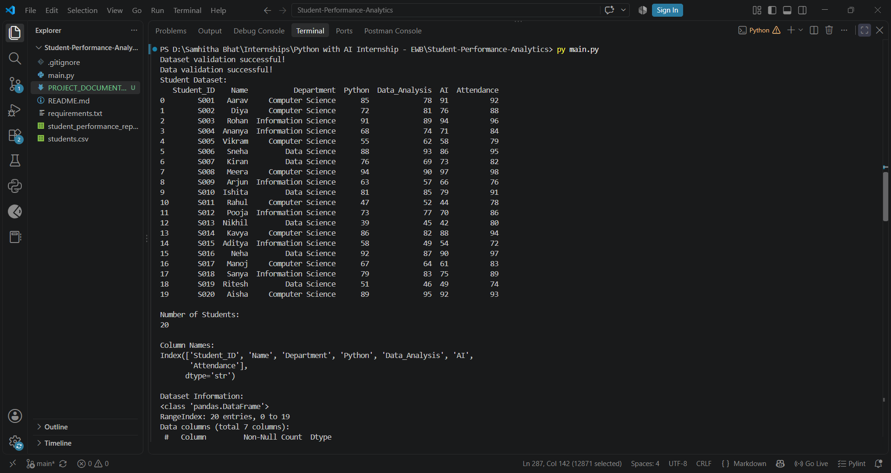
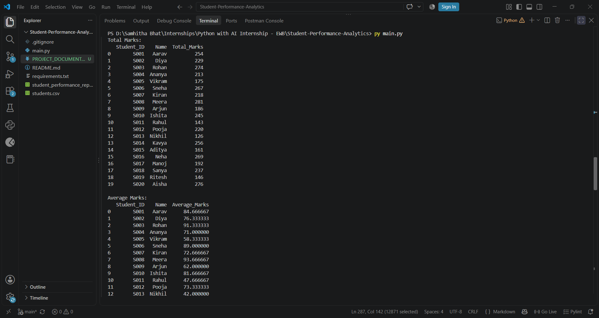
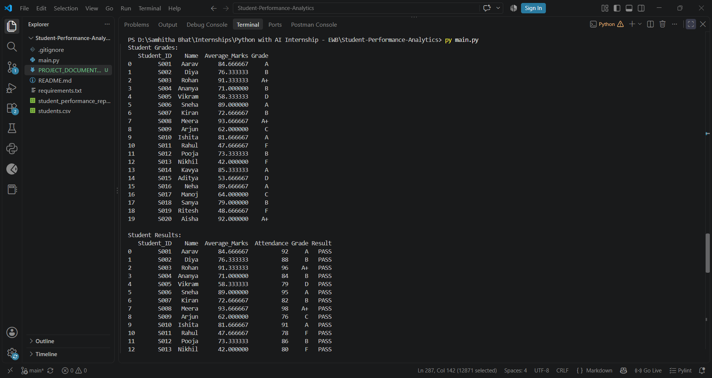
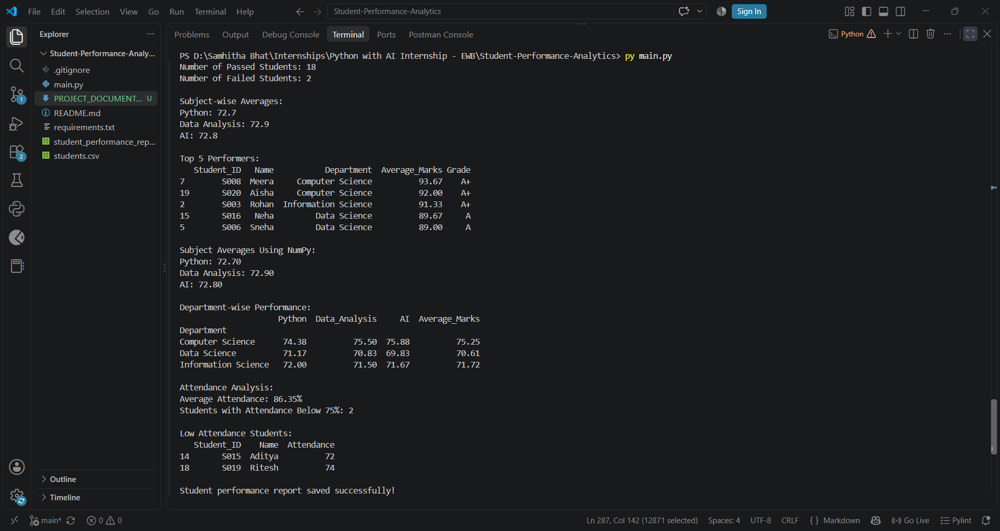

# PROJECT DOCUMENTATION

## 1. Project Title and Student Details

**Project Title:** Student Performance Analytics System

**Student Name:** Samhitha Bhat

**College Name:** Alva’s College, Moodbidri

**Internship:** Python with AI Internship

**Organization:** EWB Edu Tech Private Limited

**Programming Language:** Python

**Submission Deadline:** 15 October 2026

## 2. Project Objective

The objective of the Student Performance Analytics System is to analyze student academic performance using Python, Pandas, and NumPy.

The system processes student records containing marks in Python, Data Analysis, and Artificial Intelligence, along with attendance percentages. It calculates total and average marks, assigns grades, determines pass/fail results, and generates useful performance statistics.

The project also aims to:

- Calculate the overall class average, highest average, and lowest average.
- Analyze subject-wise and department-wise performance.
- Identify the top five performers based on average marks.
- Analyze student attendance and identify students with attendance below 75%.
- Validate the dataset to detect missing values, missing columns, and invalid marks or attendance.
- Export the analyzed student data to a CSV report for further reference.

## 3. Technologies Used

The following technologies and tools were used to develop the Student Performance Analytics System.

- **Python 3.11:** The core programming language used to implement the project logic, functions, conditional statements, and loops.
- **Pandas:** Used to load the CSV dataset, validate and process student records, calculate statistics, group data by department, sort student performance, and export the results.
- **NumPy:** Used for numerical calculations, including calculating subject-wise average marks.
- **CSV (Comma-Separated Values):** Used as the input dataset format and for storing the generated student performance report.
- **Visual Studio Code:** Used as the development environment for writing and executing the Python program.
- **Git and GitHub:** Used for version control and hosting the project repository online.

## 4. Dataset Description

The project uses a CSV file named `students.csv` as its input dataset. The dataset contains 20 student records and includes student identification details, department information, subject marks, and attendance percentages.

### 4.1 Dataset Columns

| Column Name | Description |
|---|---|
| `Student_ID` | Unique identification number assigned to each student |
| `Name` | Name of the student |
| `Department` | Academic department of the student |
| `Python` | Marks obtained in Python |
| `Data_Analysis` | Marks obtained in Data Analysis |
| `AI` | Marks obtained in Artificial Intelligence |
| `Attendance` | Student attendance percentage |

### 4.2 Data Validation

Before analyzing student performance, the program validates the dataset to ensure that:

- All required columns are present.
- Required fields do not contain missing values.
- Marks and attendance values are numeric.
- Marks and attendance percentages fall within the range of 0 to 100.

If the dataset fails these checks, the program raises an error instead of proceeding with invalid data.

### 4.3 Dataset Processing

After validation, the program loads the records into a Pandas DataFrame. It then calculates total marks, average marks, grades, and results, and performs class-level, subject-wise, department-wise, and attendance analysis.

## 5. Implementation

The Student Performance Analytics System is implemented using Python, Pandas, and NumPy. The program follows a sequence of data loading, validation, processing, analysis, and report generation steps.

### 5.1 Loading the Dataset

The program uses Pandas to read `students.csv` and store the student records in a DataFrame.

```python
students = pd.read_csv("students.csv")
```

### 5.2 Validating the Dataset

The program checks whether all required columns are available. It also checks for missing values, converts marks and attendance to numeric values, and ensures that all marks and attendance percentages are between 0 and 100.

If any validation check fails, the program raises a `ValueError`.

### 5.3 Calculating Total and Average Marks

The program calculates each student's total marks across three subjects: Python, Data Analysis, and AI.

```python
students["Total_Marks"] = (
    students["Python"]
    + students["Data_Analysis"]
    + students["AI"]
)

students["Average_Marks"] = students["Total_Marks"] / 3
```

### 5.4 Assigning Grades

The `calculate_grade()` function assigns grades based on each student's average marks.

| Average Marks | Grade |
|---|---|
| 90 and above | A+ |
| 80 to below 90 | A |
| 70 to below 80 | B |
| 60 to below 70 | C |
| 50 to below 60 | D |
| Below 50 | F |

The function uses conditional statements to select the appropriate grade.

### 5.5 Determining Pass or Fail

The `check_result()` function determines the result using average marks and attendance.

A student receives **PASS** if the average marks are at least 40 and attendance is at least 75%. Otherwise, the student receives **FAIL**.

### 5.6 Calculating Class Statistics

The program calculates the overall class average, highest student average, lowest student average, and the number of students who passed or failed.

Pandas functions such as `mean()`, `max()`, and `min()` are used to calculate these statistics.

### 5.7 Performing Subject-wise Analysis

The program calculates the average marks for Python, Data Analysis, and AI using Pandas. It also converts the subject marks into a NumPy array and calculates the subject averages using `np.mean()`.

A `for` loop displays the NumPy results for each subject.

### 5.8 Analyzing Department-wise Performance

The program uses Pandas `groupby()` to calculate average marks by department. This helps compare performance across the departments represented in the dataset.

### 5.9 Identifying Top Performers

The program sorts student records by average marks in descending order and selects the top five students using `sort_values()` and `head(5)`.

### 5.10 Analyzing Attendance

The program calculates the average attendance percentage and identifies students whose attendance is below 75%.

### 5.11 Generating the Output Report

After completing the analysis, the program exports the processed student records to `student_performance_report.csv`.

```python
students.to_csv("student_performance_report.csv", index=False)
```

The generated report includes the original student information and the calculated performance fields, including total marks, average marks, grades, and results.

## 6. Key Features

The Student Performance Analytics System provides the following features:

1. **Dataset Loading:** Loads student records from a CSV file using Pandas.
2. **Data Validation:** Checks required columns, missing values, numeric values, and valid ranges for marks and attendance.
3. **Total Marks Calculation:** Calculates each student's total marks across three subjects.
4. **Average Marks Calculation:** Calculates each student's average marks.
5. **Grade Assignment:** Assigns grades from A+ to F based on average marks.
6. **Pass/Fail Classification:** Determines student results using average marks and attendance criteria.
7. **Class Statistics:** Calculates the class average, highest average, lowest average, and pass/fail counts.
8. **Subject-wise Analysis:** Calculates average marks for Python, Data Analysis, and AI.
9. **NumPy Calculations:** Uses NumPy to calculate subject-wise averages.
10. **Top Five Performers:** Identifies the five students with the highest average marks.
11. **Department-wise Analysis:** Calculates average performance for each department.
12. **Attendance Analysis:** Calculates average attendance and identifies students with attendance below 75%.
13. **CSV Report Generation:** Exports the analyzed data to `student_performance_report.csv`.
14. **Reusable Functions:** Uses separate functions for grade calculation and pass/fail classification.
15. **Loop-based Processing:** Uses a `for` loop to display NumPy subject averages.

## 7. Output and Screenshots

The program was executed successfully using the sample student dataset containing 20 records. It displays the dataset, validation messages, student marks, grades, results, class statistics, subject averages, top performers, department-wise performance, and attendance analysis.

### 7.1 Summary of Results

| Metric | Result |
|---|---:|
| Total Students | 20 |
| Overall Class Average | 72.80 |
| Highest Student Average | 93.67 |
| Lowest Student Average | 42.00 |
| Students Passed | 18 |
| Students Failed | 2 |
| Average Attendance | 86.35% |
| Students with Attendance Below 75% | 2 |

### 7.2 Top Five Performers

| Student | Average Marks | Grade |
|---|---:|---|
| Meera | 93.67 | A+ |
| Aisha | 92.00 | A+ |
| Rohan | 91.33 | A+ |
| Neha | 89.67 | A |
| Sneha | 89.00 | A |

### 7.3 Subject-wise Average Marks

| Subject | Average Marks |
|---|---:|
| Python | 72.70 |
| Data Analysis | 72.90 |
| AI | 72.80 |

### 7.4 Generated Report

After successful execution, the program creates `student_performance_report.csv`. This file contains the original student records along with the calculated total marks, average marks, grades, and pass/fail results.

### 7.5 Screenshots

**Screenshot 1: Dataset Validation and Student Data**



**Screenshot 2: Total and Average Marks**



**Screenshot 3: Student Grades and Results**



**Screenshot 4: Performance Summary and Report Generation**



## 8. Final Outcome

The Student Performance Analytics System was successfully developed and executed using Python, Pandas, and NumPy.

The program validates the input dataset, processes 20 student records, calculates total and average marks, assigns grades, determines pass/fail results, and generates class-level and subject-wise statistics.

It also identifies the top five performers, compares department-wise performance, analyzes student attendance, and exports the processed data to `student_performance_report.csv`.

The project demonstrates the practical application of Python programming concepts, data manipulation with Pandas, numerical calculations with NumPy, conditional statements, loops, reusable functions, and CSV file handling.

The successful execution of the program confirms that the implemented analysis and report-generation workflow works with the provided sample dataset.

## 9. Challenges and Learning Outcomes

### 9.1 Challenges Faced

During the development of this project, the main areas requiring attention included:

- Validating the dataset to ensure that all required columns were present.
- Handling missing values and checking that marks and attendance were numeric and within the valid range.
- Implementing grade calculation and pass/fail conditions accurately.
- Combining Pandas DataFrame operations with NumPy numerical calculations.
- Organizing the analysis results and exporting the processed data into a CSV report.

### 9.2 Learning Outcomes

Through this project, the following concepts and skills were applied and strengthened:

- Reading and processing CSV files using Pandas.
- Working with DataFrames and performing data validation.
- Writing reusable Python functions.
- Applying conditional statements and loops.
- Performing numerical calculations using NumPy.
- Calculating descriptive statistics and subject-wise averages.
- Grouping and comparing data by department.
- Sorting records to identify top-performing students.
- Generating output reports using CSV files.
- Managing and documenting a project using Git and GitHub.

This project provided practical experience in developing a data analysis application and presenting its results in a structured format.

## 10. GitHub Repository Link

The source code, input dataset, generated report, and project documentation are maintained in the following GitHub repository.

**Project Name:** Student Performance Analytics System

**GitHub Repository:** https://github.com/SamhithaBhatN/Student-Performance-Analytics

The repository contains the Python implementation, dataset, dependency list, README, generated performance report, and project documentation.